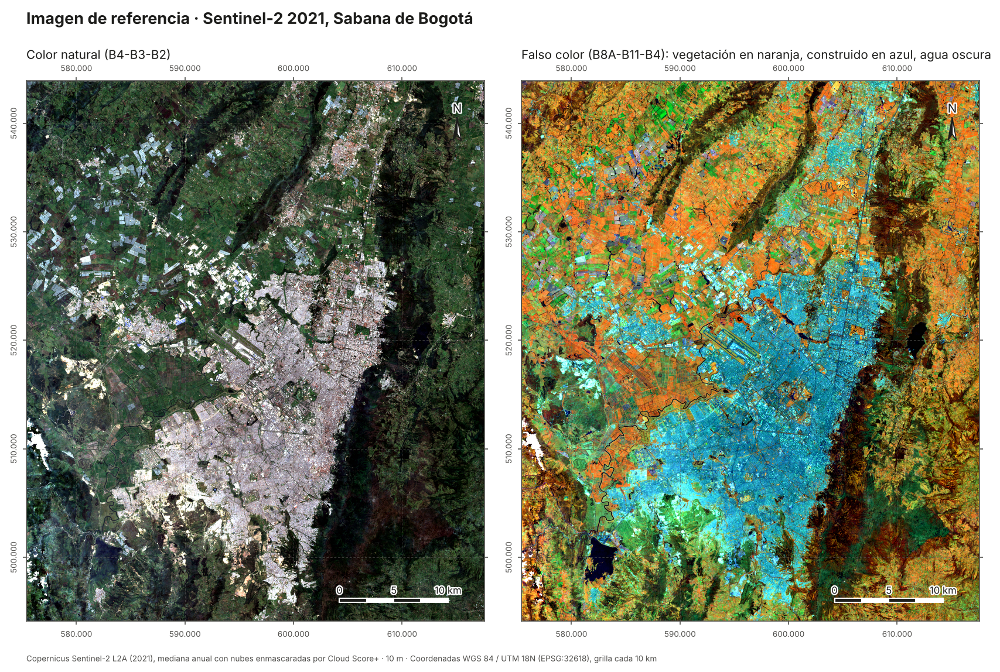
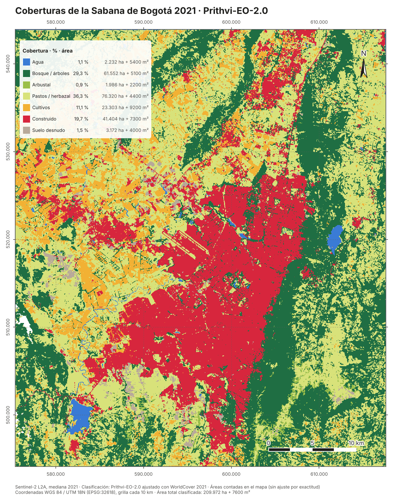

# sabana-landcover-fm

**Does a geospatial foundation model map land cover better than the classic methods, in a real Andean landscape?**
This repo fine-tunes **Prithvi-EO-2.0** (NASA/IBM, 300 M parameters) on Sentinel-2 imagery of the Sabana de Bogotá. It compares the result with three other maps built on the same pixels:

| Method | What it is |
|---|---|
| **K-Means** | the unsupervised approach of my first Cerros Orientales analysis, rebuilt so that clusters mean the same thing everywhere |
| **Random Forest** | the classic supervised pixel classifier (6 bands + NDVI, NDWI, NDBI) |
| **Dynamic World** | Google's near-real-time global product, used as is |
| **Prithvi-EO-2.0 + UNet** | the foundation model, fine-tuned on WorldCover 2021 labels |

All four maps are judged against **490 photo-interpreted reference points** in held-out spatial blocks. Each map gets overall accuracy, F1 and IoU per class with confidence intervals, plus area estimates in hectares, following remote-sensing good practice (Olofsson et al. 2014; Stehman 2014).

> **Status:** the Earth Engine export, the K-Means and Random Forest baselines and the Prithvi-EO-2.0 fine-tuning (40 epochs on a T4) are done, and the full Prithvi map is below. **Accuracy results are pending the labelling of the 490 reference points.** The results table stays empty until then.

## Reference image: Sentinel-2, 2021

<p align="center"></p>

This is the input every map is built from: the 2021 Sentinel-2 L2A median, with clouds masked by Cloud Score+, 10 m, in the six bands that Prithvi-EO-2.0 expects (B2, B3, B4, B8A, B11, B12).
- **Natural colour (left):** Bogotá is the light grey area, the Cerros Orientales are the dark band to the east, and the white rectangles to the north-west are flower greenhouses.
- **False colour B8A-B11-B4 (right):** this is the combination the labelling protocol uses. Vegetation shows in orange, built-up and greenhouses in blue, and water almost black. Crops and pastures, which look alike in natural colour, separate here by tone.

The full composite weighs 328 MB, more than GitHub allows, so it is not in the repository. [`gee/01_export_dataset.js`](gee/01_export_dataset.js) regenerates it exactly. The repository has a light copy in natural colour (8 bits, 20 m) for viewing in QGIS: [`resultados/s2_2021_color_natural_20m.tif`](resultados/s2_2021_color_natural_20m.tif). The figure is drawn by [`scripts/mapa_sentinel.py`](scripts/mapa_sentinel.py).

## Prithvi-EO-2.0 map of the Sabana, 2021

<p align="center"></p>

The map reproduces the structure of the Sabana:
- **Built-up:** the urban footprint of Bogotá, with the El Dorado runways and the towns along the main roads (Chía, Cajicá, Funza, Mosquera, Madrid).
- **Trees:** the forest of the Cerros Orientales as one continuous band, plus the Suba and western hills.
- **Water:** the San Rafael and Muña reservoirs and the meanders of the Bogotá River.
- **Crops:** the flat land to the west.
- **Shrubland:** almost only toward the páramo in the south-east.

The areas in the legend are **pixel counts of the map**, not estimates. The final areas, with confidence intervals, come from the reference points (Stehman 2014) and will replace them. Shrubland is probably under-mapped: it is the class with the fewest training pixels (0.5 % of the training set).

The classified raster is in [`resultados/prithvi_2021.tif`](resultados/prithvi_2021.tif) (EPSG:32618, 10 m, values 0–6, 255 = no data). The figure is drawn by [`scripts/mapa_coberturas.py`](scripts/mapa_coberturas.py).

## Results

_Pending. Filled automatically by `python -m sabana_lc evaluate` (`work/results/results.md`)._

| Map | Overall accuracy ± 95% CI | Macro F1 | mIoU |
|---|---|---|---|
| K-Means | – | – | – |
| Random Forest | – | – | – |
| Dynamic World | – | – | – |
| Prithvi-EO-2.0 | – | – | – |

## Why the evaluation is built this way

- **Spatial split.** Train, validation and test sets are 5 km blocks, and a chip is kept only if all of it lies in one split. Random pixel splits leak neighbouring pixels between train and test and inflate every score.
- **Independent reference.** The model learns from WorldCover, so measuring it against WorldCover would reward copying WorldCover's mistakes. The reference points are labelled blind on 2021–2022 high-resolution imagery ([protocol, in Spanish](docs/protocolo_verificacion.md)). Agreement with WorldCover is still reported, but separately.
- **Unbiased estimators.** The sample is stratified by WorldCover class, which is not the class set of any map under test. `evaluate.py` implements Stehman's (2014) estimators for that case. A test checks that they reduce exactly to Olofsson et al. (2014) when strata equal map classes, and a 300-run simulation checks that the 95% intervals cover the truth about 95% of the time.
- **A fair K-Means.** The original analysis fitted K-Means separately for each year, so "class 6" in 2020 and "class 6" in 2024 were different things, and areas seemed to jump by thousands of hectares between years. Here one model is fitted once, and each cluster is named after the class it overlaps most.

## Pipeline

```
gee/01_export_dataset.js     Sentinel-2 2021 median (Cloud Score+), WorldCover + Dynamic World labels,
                             5 km split blocks, stratified reference points  ->  Google Drive
python -m sabana_lc prepare  224 px chips per split, band statistics, class weights
python -m sabana_lc baselines K-Means and Random Forest maps
python -m sabana_lc train    Prithvi-EO-2.0 encoder + UNet decoder (TerraTorch), best checkpoint by val mIoU
python -m sabana_lc predict  sliding-window map of the whole Sabana (tapered overlaps, no seams)
python -m sabana_lc evaluate accuracy, F1, IoU, areas with 95% CI, figures
```

The GPU steps run in [`notebooks/train_colab.ipynb`](notebooks/train_colab.ipynb) on a free Colab T4. Everything else runs on a laptop.

Classes: water · trees · shrubland · grass/herbaceous · cropland · built-up (greenhouses included) · bare.

## Run the tests

```bash
pip install -e ".[model,test]"
pytest            # 6 tests, ~40 s on CPU: estimators + full pipeline on a synthetic scene with a 3.5 M "tiny" Prithvi
```

## Data and licences

Sentinel-2 (Copernicus), ESA WorldCover v200 (CC BY 4.0), Dynamic World (CC BY 4.0) and Prithvi-EO-2.0 (Apache 2.0) are open. No institutional data is used.

## Resumen en español

Este proyecto compara cuatro formas de mapear coberturas en la Sabana de Bogotá con Sentinel-2: K-Means, Random Forest, Dynamic World y el modelo fundacional Prithvi-EO-2.0 ajustado. Todas se evalúan contra 490 puntos verificados a mano en bloques que ningún modelo vio. Las métricas incluyen intervalos de confianza y áreas en ha + m², con los estimadores de Stehman (2014). El código está probado de punta a punta con datos sintéticos. Ya están la exportación de Earth Engine, las líneas base y el modelo Prithvi ajustado, con su mapa de 2021. Falta el etiquetado de los puntos de referencia para calcular la exactitud.

<sub>© 2026 Karen Tatiana Zamudio Quintero. All rights reserved. See [LICENSE](LICENSE).</sub>
